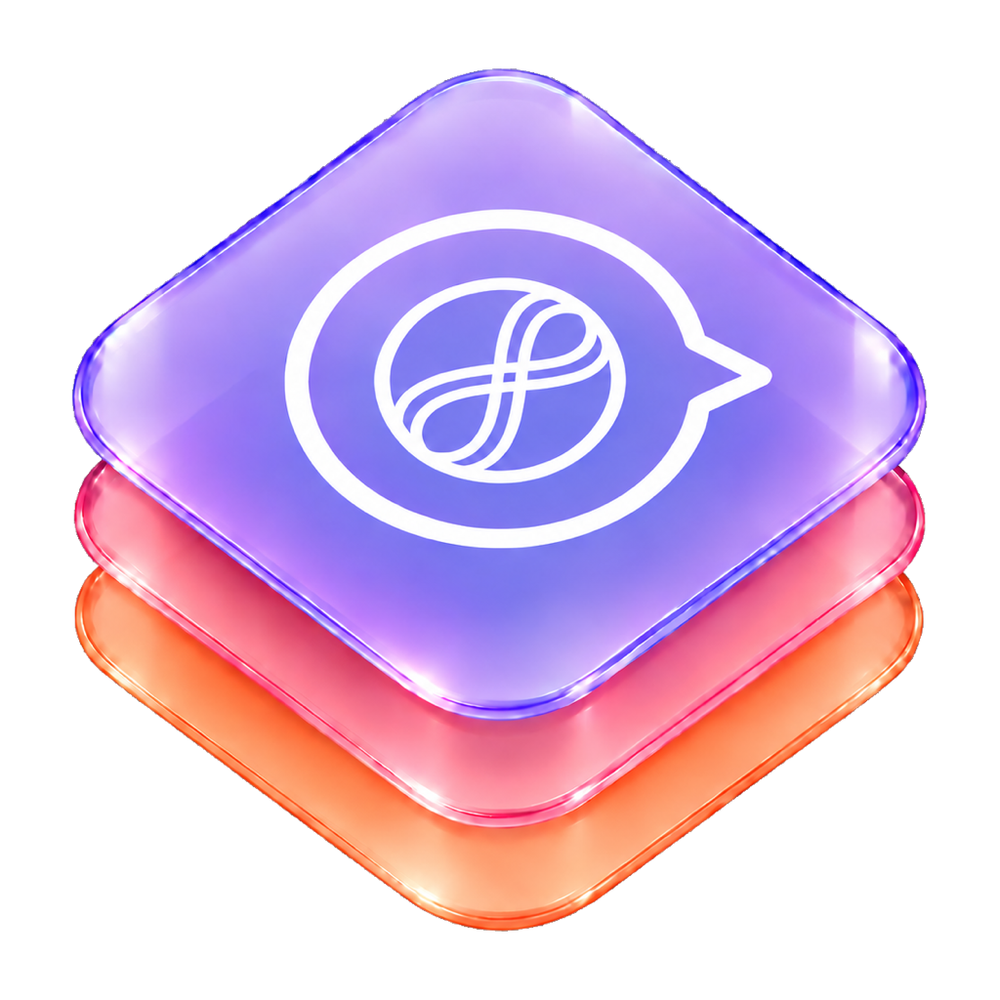

<p align="center">
  <picture>
    <source media="(prefers-color-scheme: dark)" srcset="Artwork/logo-dark.png">
    
  </picture>
</p>

# AskKit

AskKit is a receptionist for iOS 27. An app registers domains and skills. A person asks an open question. AskKit picks one skill and either replies, or shows a card from an intent the app already shipped. Answers use the on-device model, or Private Cloud Compute when the chat has chosen it, Apple reports that model is available, and the device has a network path. With no connection, Private Cloud falls back to the on-device model for that turn.

The package does not know about a particular app's screens, accounts, or catalogs. United's Ask United app is not this package.

An app that wants one lasting conversation supplies its own tools and prompt to `AskOnDeviceResponder`. The default model is on-device. Apple Watch uses Private Cloud Compute. The receptionist starts a fresh session for each hop. See [On-device answer](#on-device-answer).

Add the library product `AskKit` and `import AskKit`. The package is iOS 27.

```swift
dependencies: [
    .package(path: "../AskKit")
],
targets: [
    .target(name: "MyApp", dependencies: [
        .product(name: "AskKit", package: "AskKit")
    ])
]
```

## Turn

1. A chip tap runs that skill. No model.
2. "what about", "how about", and "also" are stitched onto the previous user question from the saved thread.
3. "What can I do?" is answered from the app's chips and skills before any model call. See [What you can ask](#what-you-can-ask).
4. An optional fast path can pick a skill before the model runs.
5. Without an `AskGuide`, hop 1 picks one domain and hop 2 picks one skill. Each hop is a new `LanguageModelSession` with zero tools and tool calling disallowed. The session uses the model saved from the chat menu.
6. With an `AskGuide`, one session routes the whole catalog. Its instructions are the app's opening, then `CAPABILITIES`, then `RULES`.
7. If a required slot is missing, one new session carries that domain's tools. The cap is 5. More than five is ignored and the skill still runs with the slots already in hand.
8. A routing session is never reused as a skill session.
9. When the guide has reply instructions, one more session rewrites the skill's facts into the spoken line. Only the paragraph before a blank line is kept. The skill's line stays if that rewrite is empty or echoes `key=value`.
10. When the guide has follow-up instructions, one more session offers a single next question. The chat shows it under the answer. Tapping it asks that question. A turn with more than one page does not offer a follow-up.

A message that asks two or three different things is split on `?`, `;`, `!`, or on `and`, `also`, or `plus`. Those parts become one turn when they resolve to different skills. The answer text stays in one speech bubble. The cards sit under that bubble and page sideways, with the next card left in view. One card has no page dots. `AskTurnResult.pages` lists each page. The saved turn keeps the first skill id and joins the page text.

Operational facts come from the app's tools and from the skill handler. They do not come from model weights.

## On-device answer

`AskOnDeviceResponder` keeps one `LanguageModelSession` for the whole conversation. A follow-up is another turn in that transcript, so "and the one after that?" can see the earlier question. `reset()` drops the session. The next question opens a new one and reads the instructions and tools again. `model` chooses the model for that session. The default is `.onDevice` (`SystemLanguageModel.default`). `.privateCloud` uses `PrivateCloudComputeLanguageModel`. The chat menu's Private Cloud choice stays with the receptionist. This responder uses the model you pass.

The session opens when the checks for that model pass. `allowModel` is left on. The operating system is 27.3 or later (`iOS 27.3`, `macOS 27.3`, `macCatalyst 27.3`, `visionOS 27.3`, and `watchOS 27.3` for Private Cloud Compute). The chosen model reports itself available. `allowModel: false` forces the fallback, which is how a test or a setting skips the model. `availability` reports which check failed. `AskOnDeviceBoundary.allows(major:minor:)` is the same 27.3 line as a plain version check.

Apple Watch has no on-device system model. A watch request does not run on the paired iPhone. Pass `.privateCloud`. `AskKitUI` is not part of the watchOS build. The chat, cards, and trace viewer use SwiftUI that watchOS does not provide. A watch app draws its own interface. Private Cloud Compute on watchOS 27 goes over the network. It needs a network path. Offline is `cause` `.offline`. The host app adds the managed entitlement `com.apple.developer.private-cloud-compute` (`AskPrivateCloudEntitlement.key`). Apple assigns that entitlement to the developer account. The key alone does not grant access. Apple's entitlement page lists iOS, iPadOS, macOS, visionOS, and watchOS 27.0 and later.

Apple's `PrivateCloudComputeLanguageModel` page lists those same platforms and does not list tvOS. The entitlement page does not list tvOS either. This layer does not call Private Cloud Compute on Apple TV. `SystemLanguageModel` lists tvOS 27.3 as beta and does not list watchOS. The on-device session in this package stays on iOS, macOS, Mac Catalyst, and visionOS, with the rest of the receptionist. An Apple TV question uses the fallback.

Private Cloud Compute is for Apple Intelligence devices. Each person has an iCloud quota. Before a cloud turn, the responder reads `quotaUsage.isLimitReached`. When that is true, or the model throws `quotaLimitReached`, the cause is `.quotaReached` and the fallback answers. A network failure while the call is running is `.offline`.

The app supplies the prompt, the tools, and the fallback. Instructions are read once, when the session opens. Tools are read then too. Each tool reads the app's current data when the model calls it, so a record saved after the session opened is still visible. Put the catalog in the tool, and keep the instructions to how to call the tools. The fit check reads that model's `contextSize`. A positive read is the window, including 4,096 on an older on-device model and 8,192 on a newer one. A failed or empty on-device read uses `legacyOnDeviceTokenWindow` (4,096) so a prompt sized for 8,192 is not sent to a device that cannot hold it. `onDeviceTokenWindow` (8,192) remains the usual newer size when a caller wants one stand-in and no read. Private Cloud Compute uses `privateCloudTokenWindow` (32,768) when its read fails. `instructionsFitComfortably` is a quarter of whichever window you pass, which leaves room for the tool results. A prompt that does not fit uses the fallback and does not open a session. A new session is prewarmed once. A follow-up reuses it and does not prewarm again. Call `reset()` when the instructions should change, such as when the day changes. The system model is not a coding model. This package does not add a custom-model backend.

`answer(_:)` asks the model for a sentence, the identifiers the tools returned, and a short reason. Pass `acceptCitation` with the ids the app actually has. Any other id is dropped, and a blank id is dropped. An empty sentence uses the fallback. A thrown error uses the fallback. A guardrail or a refusal passes `cause` `.blocked`, and the fallback should answer without repeating the person's words. The live session uses `transcriptErrorHandlingPolicy(.revertTranscript)`, so a failed turn rolls back and the next turn still has the earlier ones. A second call that arrives while a turn is running gets `cause` `.busy` and does not call the model.

`turn.engine` is `.foundationModels` or `.fallback`. `turn.continuedSession` is true when this question was sent to the session an earlier turn opened. `turn.answer.citedIDs` is the filtered list.

An app with a different shape passes its own `@Generable` type to `answer(_:generating:fallback:)`. One responder is one conversation and one answer type. That overload leaves citation filtering to the app, because the package does not know the fields. The method is available in builds that include Foundation Models.

```swift
final class Shelf {
    var items: [String: String] = ["tomatoes": "4"]
}

struct ShelfTool: Tool {
    var shelf: Shelf
    let name = "shelfLookup"
    let description = "Looks up how many of one item are on the shelf. Pass the item name."

    @Generable
    struct Arguments {
        @Guide(description: "The item name, such as tomatoes.")
        var item: String
    }

    func call(arguments: Arguments) async throws -> String {
        Self.lookup(arguments.item, stock: shelf.items)
    }

    /// Pure, so a test can call it without a model session.
    static func lookup(_ item: String, stock: [String: String]) -> String {
        let name = item.trimmingCharacters(in: .whitespacesAndNewlines)
        guard !name.isEmpty, let count = stock.first(where: { $0.key.localizedStandardContains(name) })?.value else {
            return name.isEmpty ? "Which item?" : "Nothing named \(name) is on the shelf."
        }
        return "\(name): \(count)"
    }
}

let shelf = Shelf()
let responder = AskOnDeviceResponder(
    instructions: {
        "You answer questions about what is on the shelf. Use the shelf tool for every count. Do not invent one."
    },
    tools: { [ShelfTool(shelf: shelf)] },
    acceptCitation: { shelf.items.keys.contains($0) },
    fallback: { _, cause in
        if cause == .blocked {
            return AskOnDeviceAnswer(text: "Sorry, this feature isn't designed to handle that kind of input.")
        }
        let lines = shelf.items.sorted { $0.key < $1.key }.map { "\($0.key): \($0.value)" }
        let text = lines.isEmpty ? "The shelf is empty." : lines.joined(separator: ", ")
        return AskOnDeviceAnswer(text: text)
    }
)
let turn = await responder.answer("How many tomatoes?")

// Apple Watch. Same tools and fallback. The session is Private Cloud Compute.
let watch = AskOnDeviceResponder(
    model: .privateCloud,
    instructions: {
        "You answer questions about what is on the shelf. Use the shelf tool for every count. Do not invent one."
    },
    tools: { [ShelfTool(shelf: shelf)] },
    acceptCitation: { shelf.items.keys.contains($0) },
    fallback: { _, cause in
        if cause == .quotaReached {
            return AskOnDeviceAnswer(text: "The daily Private Cloud Compute limit is used up.")
        }
        if cause == .offline {
            return AskOnDeviceAnswer(text: "Private Cloud Compute needs a network connection.")
        }
        let lines = shelf.items.sorted { $0.key < $1.key }.map { "\($0.key): \($0.value)" }
        let text = lines.isEmpty ? "The shelf is empty." : lines.joined(separator: ", ")
        return AskOnDeviceAnswer(text: text)
    }
)
let watched = await watch.answer("How many tomatoes?")
```

An app that wants different fields uses its own `@Generable` type for every turn on that responder.

```swift
@Generable
struct StockLine: Sendable {
    @Guide(description: "One sentence, using only the shelf tool.")
    var text: String
}

let counted = await responder.answer("How many tomatoes?", generating: StockLine.self) { _, _ in
    StockLine(text: "The shelf is empty.")
}
```

## What you can ask

"What can I do?", "What can you help with?", and the same kind of question are answered from the app's chips and skills. No model call. The bubble is `You can ask me questions like Charge status or Range and I can help with that.` The two examples are the first chip titles, then skill titles if there are fewer than two chips. The answer text is its own bubble. A card under that bubble lists every skill, grouped by domain. A skill whose id is `unknown` is left off that card. "What can I do?" stays one page.

A question that matches no skill gets `I can't help with that.` and then the same examples and card. When that assistant has Apple sources turned on, the miss instead writes a reply with those tools. A tool result becomes the answer and the fact card. No tool result keeps the miss card. An app that registers a skill with id `unknown` still handles that miss itself.

Apple's Foundation Models guardrails run on every model call. A `guardrailViolation` or a `refusal` while choosing a skill stops the turn. The reply is `Sorry, this feature isn't designed to handle that kind of input.` plus the examples. The person's words are not repeated. A guardrail during slot filling, the reply rewrite, or the follow-up drops that model text and keeps the skill's own line.

## Skills

```swift
let ask = try AskAssistant(AskConfiguration(
    assistantName: "Ask Pantry",
    persistence: .memory,
    domains: [
        AskDomain(id: "recipes", summary: "Cooking", routingNotes: "Food questions stay here.")
    ],
    skills: [
        AskSkill(
            id: "whatsForDinner",
            domainID: "recipes",
            title: "Dinner",
            summary: "Suggest dinner from what is on hand",
            contextKeys: ["pantry"],
            routingNotes: "Dinner, cook, and meal questions.",
            fulfillment: .reply { invocation in
                let pantry = invocation.context.value(for: "pantry") ?? "what you have"
                return AskReply(text: "Cook \(pantry).", spoken: "Cook \(pantry).", actions: [
                    AskAction(id: "open-recipes", title: "Open recipes")
                ])
            }
        )
    ],
    context: {
        AskContext(
            promptBlock: "signedIn=true pantry=pasta,tomatoes",
            values: ["signedIn": "true", "pantry": "pasta,tomatoes", "userID": "42"]
        )
    },
    chips: { context in
        let pantry = context.value(for: "pantry") ?? "what you have"
        return [AskChip(id: "dinner", skillID: "whatsForDinner", title: "Cook \(pantry)?")]
    }
))
```

The model sees `assistantName`, each domain and skill `summary` and `routingNotes`, `requiredSlots`, and `promptBlock`. The spoken line comes from the skill unless the guide asks the model to rewrite `facts`.

## Guide

`AskGuide()` starts from four built-in prompts: `defaultRouteOpening`, `defaultRouteRules`, `defaultReplyInstructions`, and `defaultFollowUpInstructions`. A string appends to that block. `.replace` uses only the app's text. `.replace("")` turns that block off. AskKit still fills in the catalog and the labeled sections.

```swift
guide: AskGuide(
    routeOpening: .append("This assistant answers questions about cooking and the pantry."),
    routeRules: .append("""
    What to cook tonight is dinner. What is already on the shelf is stock.
    """),
    replyInstructions: .append("Do not invent ingredients."),
    followUpInstructions: .replace("Offer nothing unless the person asked about dinner.")
),
context: {
    AskContext(
        promptBlock: "onHand=pasta,tomatoes",
        values: ["onHand": "pasta, tomatoes"],
        sections: [AskPromptSection(title: "PANTRY", text: "On hand: pasta, tomatoes.")]
    )
}
```

The route instructions the trace shows are the resolved opening, a blank line, `CAPABILITIES` built from the domains and skills, a blank line, and the resolved `RULES`. The route prompt is `CONTEXT`, `EARLIER` when there is one, and `REQUEST`. `resolvedRouteOpening` and the other `resolved…` properties are the full text after append or replace.

The reply prompt is `QUESTION`, `SKILL`, `FACTS`, then each `AskPromptSection` under its own title, then `CONVERSATION`. `FACTS` is the skill's `facts` string, or its spoken line when `facts` is omitted. The spoken rewrite keeps only the paragraph before the first blank line, so a background copy of a section such as `GARAGE` does not replace the short answer. A follow-up prompt adds `JUST ASKED`, `SKILL JUST ANSWERED`, and `ALLOWED`.

Rich text is off by default (`AskMarkdownSelection`, key `AskKit.markdown`). The composer’s rich-text control turns it on. Off keeps plain bubbles and `defaultReplyInstructions` (short spoken lines, no Markdown). On renders assistant bubbles with [Textual](https://github.com/gonzalezreal/textual) (`StructuredText`, including math) and switches the writer to `defaultRichReplyInstructions` (lists, tables, headings, code, and math). The same `replyInstructions` append or replace applies on top of whichever default is active. Plain mode still stops before a blank line and caps at 600 characters (~150 tokens). Rich mode keeps the full reply up to an `AskReplyBudget` sized from the active model’s `contextSize`: a smaller slice on-device, a larger slice on Private Cloud Compute, or the Private Cloud response-length picker when that is set. Sessions also pass that budget as `maximumResponseTokens` when rich text is on (and whenever Private Cloud length is not Automatic). `AskGuide.plainSpeech` strips Markdown for the spoken line, Siri dialog, and Copy.

`guide.routeInstructions(domains:skills:)` returns that route block, so an app can read the same text the model sees.

An app runs a turn through `AskAssistant`. `handle(utterance:)` records the trace as `composer`. Pass `entry` for another origin, such as `.siri` or `AskTraceEntry(rawValue: "voice")`. Pass `priorUserQuestions` when this call should stitch a follow-up onto questions the store does not have yet. An empty list uses the saved thread.

```swift
let chips = await ask.chips()
let result = await ask.handle(utterance: "What's for dinner?")
let fromChip = await ask.handle(chip: chips[0])
let fromSiri = await ask.handle(
    utterance: "what about the gate",
    entry: .siri,
    priorUserQuestions: ["What's my flight status?"]
)
let turns = try ask.transcript()
if let id = turns.last?.id {
    let card = await ask.intentCard(for: id)
}
try ask.clearThread()
```

`chips()` returns at most three. `handle(chip:)` runs that skill and does not open a model session. `transcript()` is the saved thread. `intentCard(for:)` builds the card again. The view is not stored. `clearThread()` deletes that assistant's thread.

`fastPath` skips the model when it returns a route. `tools` supplies at most five tools for the slot-fill session. On a reply those tools are their own specialist, in their own session, separate from the Apple specialists. Router sessions and chip taps do not receive tools. `omittedSlotKeys` are dropped before save. The skill for that turn still sees them.

`specialists` is how an app adds its own profiles. Each `AskSpecialist` has an id, a title, a symbol, a working title, instructions, a tool builder, and a `matches` check. A match runs before any Apple specialist. The working title is the status line beside the thinking orb while that profile is active. Open ended registers a clock and a photos specialist (`AskPhotos.specialist`). Garage registers battery, cabin, and trip. Pantry registers clock, stock, and dinner. Desk registers visitor, room, and packages.

Each route, specialist, and follow-up is a new session with an empty transcript. The last eight spoken turns are the `CONVERSATION` block in the prompt, so "this" and "that" have context and an earlier answer is not a tool result. A router session drops tool entries and reasoning before the model sees them, and rolls a failed call back. A specialist session keeps its transcript when a call fails, so a tool result can still become the card.

`webMetadata` is off until the app sets it. It is not one of the sources in the tools sheet. A question that contains an http or https address runs a web specialist first, with the working title "Reading the page". The lines are the page title, `Page:` and the address, and the description from the page. A page that cannot be read says so. The Open ended sample turns this on. There is no web search.

Tool arguments use generation guides. Calendar and reminder actions are read, birthdays, add, update, or delete. Music which includes playlist, play, pause, next, and previous. Health kind includes blood pressure, workouts, and sleep. Hours are 0 to 23, minutes are 0 to 59, and a day offset stays inside the list the tool already prints. Health kind, weather span, music which, and alarm repeats are closed lists. Counts stay inside the same bounds the parsers already enforce. A pattern guide is not used. A guide the model cannot apply is traced as unsupported guide and the skill line stays. A reply the schema cannot parse does the same. A context window, a rate limit, a timeout, an unsupported language, a busy session, or an on-device model that is not ready is one short sentence. Private Cloud Compute says when it cannot connect, is at its limit, or is unavailable. Guardrail and refusal stay the capabilities line. Debug text stays in the trace. When the on-device model or Private Cloud Compute is down, the trace records `onDevice` or `privateCloud` with the reason. Offline Private Cloud is `privateCloud` with `offline`. The saved choice does not change.

`appleAccess` turns on Apple sources for the reply: calendar, reminders, contacts, location, health, music, weather, and alarms. Nothing is on until the app sets it. That set is what the composer can offer. The person turns sources on or off there, and every allowed source may stay on. The choice is remembered for that assistant name under `AskKit.appleAccess.<name>`. With no saved choice, the app's set is what runs. `AskAppleSelection.rememberIfNeeded` can save a starting subset once. A reply loads only the specialists the question needs: matching host specialists, then that skill's tools, then each matching Apple source. At most three specialists run on a turn, each in its own session, and each holds at most five tools. A specialist the question does not name stays off. A fourth match is dropped. More than five tools on a skill keeps the skill's own line. A tool asks for permission the first time it runs. A denial comes back as "Not allowed." and the answer must not invent the missing fact. The tool text is part of the facts for that rewrite, so the 600-character limit and the equals-sign check still apply. When a reply used one of these tools, a fact card sits under the speech bubble. `appleCard` can replace that card. Return nil to keep the built-in one. Skills that already draw a card keep that card, and the Apple lines appear under it. Calendar can add, change, or remove one event, including a place and notes, and can read birthdays from the birthday calendar. Reminders can add, change, or remove one reminder, including notes and a priority of high, medium, or low. A list answer says how many are open, and the card lists each one. An open row shows a circle that runs Complete Reminder. A completed row shows a filled checkmark that runs Reopen Reminder. Siri uses those same intents. Contacts can add, change, or remove one person, and can list contacts added recently (last week, last month, or a day count) by tracking Contacts change history after a baseline sync. Weather stays read-only. Location answers where you are, looks up a place you name, and lists places nearby. The card shows a map and the address, and Get Directions opens that place in Maps. Each place on a nearby card has its own button. Coordinates stay off that answer unless the question asked for them. A question that names one source leaves the others off, so a calendar day is not answered with reminders. Each matching contact is its own card. An email question says the email. A week of steps, energy, distance, flights, or exercise is the total for the last seven days. A month is the calendar month through today, and a year is the calendar year. The health card shows that number and a chart. Steps, energy, distance, flights, and exercise use bars. Heart rate and measurements such as weight use a line. Both axes are labeled. Day, Week, Month, and Year sit on the card and run Show Health Range, so Siri can switch the range too. The chart opens on the range the question asked. A song, album, or playlist question each return their own cards, up to three. Play Song, Play Album, and Play Playlist on those cards start playback. The music tool can also start playback when the person asks to play a title. Nothing playing, no match, and music unavailable stay fact cards and have no play button. What is playing is a now-playing card with artwork, a scrubber, and play, pause, previous, and next. Starting playback from the music tool returns that same card. The last song played is a separate read, and it is not answered with the song in the queue. A forecast is one card. A week lists each day on that card. An hourly forecast lists the hours on that day's card. The weather card shows the Apple Weather mark and links to the legal page. Alarms can add several in one question. Each alarm can carry a button label, an SF Symbol, and a registered action. `AskAlarms.register` supplies that action as a Live Activity intent. The built-in action id is `open`. An unknown id is left off that alarm. One alarm is one card, and later alarms in the same answer page beside it.

The host app owns the usage strings and entitlements. Calendar needs `NSCalendarsFullAccessUsageDescription`. Reminders need `NSRemindersFullAccessUsageDescription`. Contacts need `NSContactsUsageDescription`. Location needs `NSLocationWhenInUseUsageDescription`. Health needs `NSHealthShareUsageDescription` and the HealthKit entitlement. It reads steps, heart rate, active energy, walking distance, flights, exercise time, weight, height, body fat, resting heart rate, blood pressure, blood glucose, oxygen, temperature, breathing rate, VO2 max, workouts, and sleep. A question that does not name one of those returns every reading. Music needs `NSAppleMusicUsageDescription`. It reads what is playing, searches songs, albums, and playlists, can start playback, and can pause, skip, or go back. Play is also a button on the song, album, or playlist card. The now-playing card adds a scrubber and play, pause, previous, and next. Alarms need `NSAlarmKitUsageDescription`. There is no AlarmKit entitlement. The system asks the first time alarms are read, changed, or set. A photos specialist needs `NSPhotoLibraryUsageDescription`. It searches the library with PhotoQueryKit for screenshots, Live Photos, panoramas, HDR, depth, timelapse, slow‑mo, favorites, hidden items, albums, pixel size, date ranges, content words, sort order, and photos near latitude/longitude within a meter radius. It can also list album titles. Result lines include subtypes, duration, aspect ratio, coordinates, Vision labels, and OCR when indexed. Content search uses an on-device Vision index stored in Application Support (not CloudKit), with a saved `lastIndexDate`. `AskPhotos.prepareIndexOnLaunch()` reloads that store and indexes only photos newer than the last save. When the index is empty, the thinking line says `Photos need indexing`, then `Indexing photos…` with `12 of 200`, then searches. Attached-photo questions such as where this picture was taken stay on the image facts path. The Garage sample allows all eight. The first launch turns on calendar, reminders, contacts, location, and health. Music, weather, and alarms stay off until the person turns them on. Weather uses the location permission to read the forecast where you are. A city named in the question is the forecast place. The card shows Apple Weather attribution. The WeatherKit capability has to be on for the App ID before the entitlement key is added. Asking about the next drive can show the fact card. The calendar tool reads one day. 0 is today, 1 is tomorrow, through 13. Negative numbers are past days through -13. Birthdays use a dedicated birthdays read from that start day. Each line names that weekday and date, and another day is another call. The tool lists those numbers beside the weekday, and a result for a different weekday than the one asked is read again. A health question that names a measurement and never calls the health tool still reads that measurement. A week question reads the last seven days. A month question reads the calendar month through today, and a year question reads the calendar year. The card reads the series again when the person changes the range. A place question on a skill whose facts say that only a tool result may be stated still looks that place up when the location tool never ran. Nearby does that lookup for places around the person. A named calendar day is read when that day is missing. An email question looks up the contact when the email is missing. Adding an event, a reminder, or a contact says it was added only when the tool line starts with Added. A change starts with Updated. A removal starts with Removed. Several matches, or none, change nothing. The Open ended sample allows the same eight and starts with the same five. It has one skill and two specialists, the clock and photos. Garage, Pantry, and Desk each register three host specialists with working titles so the status line names the lookup. Every question other than "What can I do?" is sent to the model the menu has selected, on-device or Private Cloud. The person may ask anything. A greeting, thanks, or small talk is answered in one or two sentences and does not call the tools. A time question uses the clock specialist and no Apple tool. A photo-library question uses the photos specialist. A calendar, reminder, contact, place, health, music, weather, or alarm question says only what a tool returned. When a tool says it is not allowed, the reply says it cannot see that. When the skill facts say that only a tool result may be stated, a rewrite of one of those questions that did not use a tool is dropped and the skill's own line stays. Open ended uses that rule, so an earlier day's events are not reused for a later day. Calling the same tool again with the same arguments stops the reply and answers from the results already read.

```swift
fastPath: { utterance in
    utterance.localizedCaseInsensitiveContains("dinner") ? AskRoute(skillID: "whatsForDinner") : nil
},
tools: { domain in
    domain == "recipes" ? [PantryTool()] : []
},
specialists: [
    AskSpecialist(
        id: "pantry.clock",
        title: "Clock",
        symbolName: "clock",
        workingTitle: "Checking the time",
        instructions: "Call the clock tool once and say the time it returns.",
        tools: { [ClockTool()] },
        matches: { question in
            question.split { !$0.isLetter && !$0.isNumber }
                .contains { $0.caseInsensitiveCompare("time") == .orderedSame || $0.caseInsensitiveCompare("clock") == .orderedSame }
        }
    ),
    // Photo library search via PhotoQueryKit. Needs NSPhotoLibraryUsageDescription.
    AskPhotos.specialist(id: "pantry.photos")
],
// At launch: reload Application Support index, index only photos newer than lastIndexDate.
// Task { await AskPhotos.prepareIndexOnLaunch() }
appleAccess: [.calendar, .reminders],
appleCard: { name, lines in
    nil
},
omittedSlotKeys: ["recordLocator"]
```

## Chat

`AskChatView` shows the chips, the transcript, and a composer over a soft tint gradient. The navigation bar centers a Liquid Glass title pill and keeps other actions in a top-trailing ellipsis menu; pass `menu:` to add host items there. `AskChatAppearance` sets the tint, logo, bubble colors, placeholder, empty state, and thinking title. The chat copies `tint` into `askTint` for card fills, glyphs, and actions. A host that draws a card outside the chat sets `.environment(\.askTint, color)`. When `askTint` is nil, cards use `Color.accentColor`. With no messages, the middle of the chat shows a symbol, a title, and a description. The symbol defaults to the logo, and the title defaults to the toolbar title. `emptyLogo`, `emptyTitle`, and `emptyMessage` replace them. The composer is one Liquid Glass rounded rectangle. [BorderBeamKit](https://github.com/Jakubantalik/Libraries.dev/tree/main/packages/border-beam/ports/ios/BorderBeamKit)'s medium beam travels that edge in shades of the same palette as the listening glow, and only while the field is empty, no photo is attached, and the keyboard is down. A plus in the logo's place opens Take Photo, Attach Photo, or Add File. Foundation Models reads images, so a file has to be JPEG, PNG, HEIC, HEIF, GIF, TIFF, BMP, WebP, AVIF, or JPEG 2000. Up to four pictures go out with the question. Date, place, camera, megapixels, and coordinates stored in the file are added to the reply facts. A later question about where that picture was taken, when it was taken, what phone took it, or its megapixels, still uses it. The answer names the place and shows the map. Coordinates stay off unless the question asked for them. A file with no place says so and keeps the date. A file with no date or camera says so. Several questions in one message share one speech bubble. Each Apple source that answered, such as the map and the reminders, is its own card. The cards page only when more than one card is needed. Attach Photo selects up to the slots still open. Tap a picture and it zooms open from that thumbnail. A message with several pictures opens on the one you tapped and swipes through that set. Closing zooms back to the picture on screen. Hold it for a larger preview with Copy, Share, and Save. A picture still in the field can also be removed from that menu. The question sits on top and grows to six lines. Under it are Add, a model menu, a tools button, a streaming button, a round microphone button, and Send. The streaming button is off until it is turned on. Off keeps the thinking row until the answer is stored. On shows the first paragraph as it is written. The choice is remembered on this device in standard defaults under `AskKit.stream`. Debug builds can show a "Worked … · N step" pill above each answer; tap opens that turn's trace. The ellipsis menu's Worked summary toggle hides or shows it. The choice is remembered under `AskKit.workedTrace`, and a missing key is on. The tools button opens a thin sheet of the Apple sources this assistant allows. Each one can be turned on or off. While Private Cloud is the model that will run, a button beside the menu opens a thin sheet for reasoning, temperature, and response length. Light is the starting reasoning level. The menu switches the next answer between On-Device and Private Cloud. A phone sits beside On-Device and a cloud beside Private Cloud. A row stays disabled until that model reports it is available. When the saved choice is down and the other model is ready, the capsule shows the ready model for that turn and the saved choice stays. The choice is remembered on this device in standard defaults under `AskKit.compute`. Private Cloud Compute stays unavailable until the system says it is available and the device has a network path. With no connection, the capsule shows On-Device when that model is ready. Shortcuts use that same saved choice. Send points down in gray until there is text, then turns up in the accent color. The microphone is a tinted circle. While it is listening that circle turns red and shows a stop, Send hides, and [VoiceGlowKit](https://github.com/Jakubantalik/Libraries.dev/tree/main/packages/voice-glow/ports/ios/VoiceGlowKit)'s chat glow follows the voice along the bottom of the field in shades of the tint. Before any words stream, a smaller [ThinkingOrb](https://github.com/Jakubantalik/Libraries.dev/tree/main/packages/thinking-orbs/ports/ios/ThinkingOrbsKit) sits beside the status line. It shows working while a skill is being chosen, searching while a tool runs, and composing while the answer is written. The line reads "Looking at the question" only while the router model runs, the specialist's working title while that profile is active, "Reading" plus the specialist name while its tool runs, and "Writing an answer" for a reply with no tools. A second line names the specialist. The Cards sheet still walks working, connecting, and searching. The line shimmers. While that request is running, Send becomes a red stop. Stop plays a light haptic and the end-recording sound, cancels the request, and leaves the question in the thread without an answer. Taps play a light haptic. Starting and stopping the microphone play the system record sounds, and Send plays a sent sound. When streaming is on and a guide rewrites the answer, the first paragraph streams into the bubble as the model writes it, with a soft haptic as each new word arrives. A later paragraph, such as a copied background section, stays off the bubble. A rewrite that runs past 600 characters, or that adds an equals sign the facts did not have, is taken off the screen. The skill's own line is what stays. A date, such as Today 4:49 PM or Yesterday 8:03 PM, sits above the first message and again when a new day starts or an hour has passed. Drag the transcript to the left, as in Messages, and each bubble shows its time on the right. Paging the cards does not. When the thread is taller than the screen and you are at the top, a down button above the composer scrolls to the latest message. Long-press a bubble to copy it. On an answer, that menu also marks a good or bad response, and a debug build can open that turn's trace. Long-press a card to share a picture of it, save that picture to Photos, or copy the words on the card. The card is still drawn by the skill when the turn finishes. A new card rises into place under the answer, and the next card follows. Reduce Motion shows it at once. Older cards stay where they are. A card view is not `@Generable`, so the card itself does not stream in field by field. Pass `voiceColors` with up to seven colors to replace that palette. Set `showsMicrophone` to false to keep Send only. The host app needs microphone and speech-recognition usage strings for the mic, and a photo-library add usage string so Save can put a card or an attached photo in Photos. `embedsNavigation` is true unless the screen is already inside a stack. `onAction` receives the card or reply button.

```swift
AskChatView(
    assistant: ask,
    appearance: AskChatAppearance(
        title: "Ask Pantry",
        tint: .orange,
        logo: .symbol("fork.knife"),
        composerSymbol: "fork.knife"
    ),
    feedback: AskAnswerFeedback(votes: savedVotes) { vote in
        if let helpful = vote.helpful {
            savedVotes[vote.turnID] = helpful
        } else {
            savedVotes.removeValue(forKey: vote.turnID)
        }
        record(question: vote.question, helpful: vote.helpful)
    },
    onAction: { action in
        open(action.id)
    }
)
```

`appearance.tint` is the card tint inside `AskChatView`. A card drawn outside that view takes the same color from the environment, and uses `Color.accentColor` when `askTint` is nil:

```swift
AskGeneratedCardView(root: root, title: "Charge")
    .environment(\.askTint, .orange)
```

Leave `feedback` nil and the row stays hidden. The row reads "Was this answer helpful?" and sits under the latest answer. It stays on the previous answer while the next one is still running. A second tap on the same thumb clears it. The chat holds that selection. `votes` restores it the next time the view appears. `onVote` receives the turn id, the thumb, and the question. The answer text stays in the thread. `title`, `yesLabel`, and `noLabel` replace the copy. The selected thumb uses `appearance.tint`.

A chat the app draws itself uses the same control and the same decisions:

```swift
let anchor = AskFeedback.anchorID(in: turns)
if let anchor {
    let question = AskFeedback.question(before: anchor, in: turns)
    AskHelpfulRow(
        title: "Was this answer helpful?",
        yesLabel: "Yes, this was helpful",
        noLabel: "No, this was not helpful",
        vote: votes[anchor],
        tint: .orange
    ) { helpful in
        votes = AskFeedback.votes(votes, toggling: anchor, helpful: helpful)
        record(question: question, helpful: votes[anchor])
    }
}
```

`AskFeedbackTurn` is one row in that list: `id`, `isUser`, and `text`. `anchorID(in:)` is nil for a greeting or a question that has no earlier answer. `question(before:in:)` is the user text this answer responds to. `votes(_:toggling:helpful:)` selects the thumb, or removes it when that thumb was already selected.

A skill can change the thinking line while its turn is running. The sample skills pass a `workingTitle` into `AskChatActivity.update`, and each host specialist sets its own `workingTitle` for the same status line:

```swift
AskChatActivity.update("Checking the pantry")
```

## Context

Each turn asks the app what is true right now. That snapshot is `AskContext`. Skills read `values`. The model only sees `promptBlock`, so a private value such as `userID` can stay in `values` and out of the prompt.

A skill lists the keys it needs in `contextKeys`. An empty list means the skill receives the whole snapshot. The dinner skill above receives `pantry` and does not receive `userID`. Chips get the same snapshot, which is how "Cook pasta,tomatoes?" is built without a model call.

Pass a closure, or a type that owns the state:

```swift
struct PantrySource: AskContextSource {
    func currentContext() async -> AskContext {
        AskContext(
            promptBlock: "signedIn=true pantry=pasta",
            values: ["signedIn": "true", "pantry": "pasta", "userID": "42"]
        )
    }
}

let ask = try AskAssistant(AskConfiguration(
    assistantName: "Ask Pantry",
    domains: [/* ... */],
    skills: [/* ... */],
    source: PantrySource(),
    chips: { _ in [] }
))
```

`currentContext()` runs at the start of the turn and is what routing and chips use. Override `context(forSkill:keys:)` when one skill needs a heavier snapshot than that, such as the document that is open. The default scopes `values` to the skill's `contextKeys` and leaves `promptBlock` as it was.

## Handing a turn to an existing intent

Ask's `perform()` cannot `return try await FlightStatusIntent().perform()`. Those `perform()` methods return different opaque result types, and one method cannot branch between two `opensIntent` types.

Share the loader instead. The existing intent and the Ask skill both call it. Ask shows that loader's view, so the person sees the same card.

```swift
enum FlightStatusCard {
    struct Content {
        var spoken: String
        var view: FlightStatusView
    }

    static func load() async -> Content {
        // The body that used to live in FlightStatusIntent.perform().
        Content(spoken: "On time", view: FlightStatusView())
    }
}

// The shortcut and Siri phrase stay on the existing intent.
func perform() async throws -> some IntentResult & ShowsSnippetView & ProvidesDialog {
    let card = await FlightStatusCard.load()
    return .result(dialog: IntentDialog(stringLiteral: card.spoken), view: card.view)
}

// The Ask skill points at the same loader.
AskSkill(
    id: "flightStatus",
    domainID: "trip",
    title: "Flight status",
    summary: "Live status for a flight",
    requiredSlots: ["flightNumber"],
    routingNotes: "Flight status, gate, and boarding. Not a map unless they asked for a map.",
    fulfillment: .intent { _ in
        let card = await FlightStatusCard.load()
        return AskIntentCard(spoken: card.spoken, view: card.view)
    }
)
```

The chat shows the card, then the card's action. The view does not own that button. Sentences that repeat a fact in `coveredPhrases`, and lines such as "I can open…" when the card has an action, stay out of the bubble. `replacesBubble` shows the card alone. `spoken` can still be the full answer. The stored turn keeps the shorter bubble, and a later launch rebuilds the view through the same loader.

## Generative card DSL

When a skill has no host-drawn SwiftUI card, use `.generated`. AskKit owns a small layout IR (`AskCardNode`: `vstack`, `hstack`, `text`, `stat`, `figure`, `quote`, `eyebrow`, `badge`, `plate`, `symbol`, `divider`, `spacer`, `row`, `action`) and maps it to SwiftUI with `AskGeneratedCardView`. This is not runtime SwiftUI source. `plate` is a rounded symbol image, `symbol` is a palette SF Symbol, `eyebrow` is the small label above the hero, and the stat uses a display size. Charts, photos, and maps stay on host-drawn cards.

```swift
AskSkill(
    id: "nextDrive",
    domainID: "trip",
    title: "Next drive",
    summary: "When the next drive leaves",
    routingNotes: "The next drive on the calendar.",
    fulfillment: .generated { _ in
        AskGeneratedBlueprint(
            title: "Next drive",
            spoken: "Your next drive is at 5 p.m.",
            facts: "The next drive is at 5 p.m. Range is 210 miles.",
            coveredPhrases: ["5 p.m.", "210 miles"],
            actions: [AskAction(id: "nextDrive", title: "Trip")],
            // Optional. When nil, AskKit asks the model to compose a tree from FACTS.
            root: AskGeneratedCard.factTree(
                title: "Next drive",
                value: "5 p.m.",
                detail: "About 210 miles"
            )
        )
    }
)
```

Supply `root` when the layout is already known (Garage's Next drive sample does this). Omit it to let the model compose a shallow tree; a failed or empty compose falls back to the same fact-card shape. Action nodes must use an id from `actions`; the first match becomes the button under the card. The DSL tree is stored with the turn so the transcript and Shortcuts snippet can rebuild the view without calling the model again. Host `.intent` cards stay the path for product UI the app already ships. Generic Apple fact cards use the same renderer with a deterministic tree.

### Card specialist

`cardSpecialist` is the layout profile for compose sessions. It is not a reply ``AskSpecialist``: no tools, no question match, and it does not count toward the three specialists on a turn. AskKit ships the CARD DSL kinds and rules. An app appends or replaces those instructions the same way ``AskGuide`` customizes replies. A skill can add one-off notes with `AskGeneratedBlueprint.layoutNotes`.

```swift
cardSpecialist: AskCardSpecialist(
    id: "garage.card",
    title: "Garage card",
    symbolName: "car.side",
    workingTitle: "Laying out the card",
    instructions: .append("""
    Prefer a large stat for the main number. Put the domain in a badge.
    Keep secondary facts as short text or row lines.
    """)
)
```

`AskCardStyle` is `.snippet`, `.chat`, or `.fullScreen`. Cards read it from the environment and thin or grow their chrome. The Shortcuts snippet sets `.snippet`. The transcript sets `.chat`. An expandable chat card (`AskIntentCard.expands`) zooms into `.fullScreen` with the same App Store–style transition the photo grid uses. Photo cards keep their own zoom and leave `expands` off. Chat and snippet cards fill with the speech-bubble color (`askBubbleFill`, which defaults to the secondary system background) and put a 36-point gradient mark (`AskCardMark`) with the symbol and name at the top left. Full screen uses the page background and can show the rest of the card.

A custom transcript asks for that bubble the same way:

```swift
let bubble = AskCardTranscript.bubble(card.text, card: card)
```

`bubble` is nil when the card stands alone.

## AskIntent

`AskIntent` takes one question, runs that turn, and returns a snippet plus typed values. The dialog is the speech bubble. An `.intent` skill puts the card in the snippet, on its own. A `.reply` skill leaves the snippet empty because the reply is the dialog. Several skills in one question put every speech bubble in the dialog and every card in the snippet. The intent does not ask "what else?" A second question would replace the snippet on screen.

The shortcut returns `.result(value:dialog:snippetIntent:)`. The `value` is `[AskOutput]`, a `@UnionValue` of place, contact, reminder, music, and text. Shortcuts can pass those entities into `OpenAskDirectionsIntent`, `OpenAskCallIntent`, `OpenAskEmailIntent`, `PlayAskMusicIntent`, or `CompleteAskReminderIntent`. Each entity is `Transferable` with `ProxyRepresentation` on its `@Property` fields so Shortcuts can coerce a place name, phone, email, song title, or reminder title. The snippet intent still reads the saved turn and draws the cards again, so a button on a card runs its intent and the card refreshes. A static `.result(view:)` snapshot cannot run those buttons. In the snippet, a location card shows the place and Get Directions. It does not take a MapKit snapshot, because that call does not return while Siri is waiting and the dialog never appears. The chat still uses a live map. Swift Charts does not draw into that snapshot, so a health card draws its bars or line with shapes, already loaded, when the snippet appears. Day, Week, Month, and Year store the range and the snippet redraws. They do not open another result. Siri still speaks through `ShowAskHealthRangeIntent`. The snippet headline stays on one line. Get Directions opens Maps and does not open another result. Play starts the song, album, or playlist and does not open another result. A contact card phone or email row starts a call or opens Mail and does not open another result. The circle and the checkmark on a reminder complete and reopen in place. Siri still speaks through `CompleteAskReminderIntent` and `ReopenAskReminderIntent`. Skill action capsules stay on the chat. They are not part of the shortcut snippet.

It runs in the app, in the background, and records the trace as `shortcut`. Create the client on the main actor and register it in `App.init()`. A shortcut can launch the process before any view appears. If this line never ran, that launch stops in the dependency getter.

```swift
init() {
    let assistant = try! AskAssistant(AskConfiguration(/* ... */))
    self.assistant = assistant
    let client = AskIntentClient(assistant: assistant)
    AppDependencyManager.shared.add(dependency: client)
}
```

Pass `entry: .siri` when the trace should say Siri. Set `client.assistant` when the app swaps assistants. The registered client is the one a shortcut uses. `.memory` keeps the turn for this process. `.swiftData` keeps it for the next time the chat opens.

Shortcuts finds `AskIntent` only when the app's `AppIntentsPackage` lists `AskKitAppIntents`. An app that already has a package adds it to `includedPackages`. Then add `AskIntent()` to the app's `AppShortcutsProvider`. `CompleteAskReminderIntent` marks one reminder complete. Siri can run it with "Complete a reminder in AskKit." The circle on the card completes the reminder and draws a line through the title without opening another result. Reduce Motion shows that line at once. `ReopenAskReminderIntent` marks that reminder incomplete. Siri can run it with "Reopen a reminder in AskKit." The filled checkmark reopens it in place and takes the line back off. A phrase includes `\(.applicationName)` and cannot include the question, so Siri asks "What do you want to ask?" `OpenAskDirectionsIntent`, `PlayAskMusicIntent`, `OpenAskCallIntent`, and `OpenAskEmailIntent` show up in Shortcuts. They are not extra Siri phrases. The card buttons do not use those spoken results, so a tap does not cover the snippet.

```swift
struct GarageAppIntents: AppIntentsPackage {
    static var includedPackages: [any AppIntentsPackage.Type] {
        [AskKitAppIntents.self]
    }
}

struct GarageShortcuts: AppShortcutsProvider {
    static var appShortcuts: [AppShortcut] {
        AppShortcut(
            intent: AskIntent(),
            phrases: ["Ask \(.applicationName)"],
            shortTitle: "Ask",
            systemImageName: "bubble.left.and.bubble.right"
        )
        AppShortcut(
            intent: CompleteAskReminderIntent(),
            phrases: ["Complete a reminder in \(.applicationName)"],
            shortTitle: "Complete Reminder",
            systemImageName: "checkmark.circle"
        )
        AppShortcut(
            intent: ReopenAskReminderIntent(),
            phrases: ["Reopen a reminder in \(.applicationName)"],
            shortTitle: "Reopen Reminder",
            systemImageName: "circle"
        )
    }
}
```

An intent the app owns calls `AskIntent.answer` and returns its own result. It does not `return try await AskIntent().perform()`. Those `perform()` methods return different opaque types. `answer(_:using:)` reads the assistant and the trace entry from the registered client. `answer(_:using:entry:)` takes an assistant the intent already has. A blank question throws `AskIntentError.emptyQuestion`.

The registered client:

```swift
@Dependency var client: AskIntentClient

@MainActor
func perform() async throws -> some IntentResult & ReturnsValue<[AskOutput]> & ShowsSnippetIntent & ProvidesDialog {
    let answer = try await AskIntent.answer(question, using: client)
    return .result(value: answer.outputs, dialog: answer.dialog, snippetIntent: answer.snippet)
}
```

An assistant the intent already holds. `entry` is the trace name for this call.

```swift
@MainActor
func perform() async throws -> some IntentResult & ReturnsValue<[AskOutput]> & ShowsSnippetIntent & ProvidesDialog {
    let answer = try await AskIntent.answer(question, using: assistant, entry: .siri)
    return .result(value: answer.outputs, dialog: answer.dialog, snippetIntent: answer.snippet)
}
```

`answer.spoken` is the full spoken line. `answer.dialog` is the speech bubble, or that full line when the card stands alone. `answer.snippet` is the interactive card. `answer.view` is those same cards as a static snapshot, and the buttons in it do not run. `answer.outputs` is the typed `[AskOutput]` for Shortcuts chaining. `answer.turn` is the `AskTurnResult`. `answer.turn.id` is the stored turn the snippet reloads.

In Shortcuts, wire Ask → Get Directions by passing a place output into `OpenAskDirectionsIntent`, or Ask → Call Contact / Email Contact / Play Music the same way with contact and music outputs.

The sample app saves the selected sample and registers that assistant. Ask then uses only that sample's skills, including when a shortcut launches the app.

`AskConversation.step(after:)` says whether a card should stop the loop. `.stop` keeps the card on screen. `.askAgain` carries the follow-up prompt. `AskIntent` itself returns one snippet. A host that asks again calls `answer` for the next question and returns that snippet.

```swift
switch AskConversation(followUpPrompt: "What else can I help with?").step(after: answer.turn) {
case .stop:
    return .result(value: answer.outputs, dialog: answer.dialog, snippetIntent: answer.snippet)
case .askAgain(_, let prompt):
    let next = try await $question.requestValue(IntentDialog(stringLiteral: prompt))
    let follow = try await AskIntent.answer(next, using: client)
    return .result(value: follow.outputs, dialog: follow.dialog, snippetIntent: follow.snippet)
}
```

## Siri tools and on-device answers

These are different paths. `AskOnDeviceResponder` with `.onDevice` is an on-device Foundation Models session. It does not need the network, and its tools are session tools, not Siri tools. `.privateCloud` is `PrivateCloudComputeLanguageModel`. It needs a network. Apple Watch uses that lane and has no on-device system model. Apple TV gets neither. A Siri custom tool is a `ToolIntent` (`@AppIntent(.tool)`, or a `ToolIntent` conformance, on a 27.3 SDK). The group lab says that loop runs with Siri on the server, so it needs Private Cloud Compute connectivity. An ordinary App Intent, including the buttons on an AskKit card, still runs without that loop. The library does not mark its own intents as tools. The sample app does, for four Ask Garage readings only. Offline custom tools fail with a network message and do not pretend the on-device model failed. The lab did not announce `ToolIntent` on watchOS and did not announce a relay to the paired iPhone.

A custom tool is in scope when the app is named, the app is in the foreground, a Live Activity is up, or one of the app's entities is already in the conversation. The same four signals apply to a Siri app skill. Schemas are eligible more broadly. If a schema matches the app, adopt it, and add a custom tool only for the extra behavior. The 27.3 preview takes 40 custom tools. A lab remark that Siri can do about 30 to 32 calls was about calls inside one skill. AskKit does not treat that as a cap. A skill is optional guidance. The tool still has to perform when no skill is loaded. Order, authorization, and rollback belong in the app. A skill does not provide them. Refer to a tool with ordinary words, not the Swift type name.

`EntityCollection` is for a batch whose `perform` only needs identifiers. One entity, or a list whose fields are read, stays a resolved entity. `IntentAuthenticationPolicy` is the lock-screen policy on an intent, entity, or property (`.alwaysAllowed`, `.requiresAuthentication`, `.requiresLocalDeviceAuthentication`). `visibility: .internal` on `@Property` or `@ComputedProperty` keeps a value for the app and its widgets. Consent is a third switch. None of the three replaces a check in `perform()`. A disruptive or physical action calls `requestConfirmation` there. AskKit does not put a lock on every field. A field stays visible and allowed while locked until the app tightens that one field.

An intent that lives in a shared framework runs in a process that is already up. If nothing is up, the system prefers the extension. There is no automatic handoff from iPhone to Mac. Each app ships its own intents. `LongRunningIntent` is not adopted. AskKit's intents answer, change one reminder, or run a card button. The lab did not promise that Siri waits without a limit.

`AskCapabilities` answers "What can I do with this app?" from the registered chips and skills, before a model call. That is the in-app form of the discovery question. It is not a Siri tool trace.

The sample host, not the library, exports four read-only Siri tools and two app skills. The tools are `Read Charge Status`, `Read Driving Range`, `Find Nearest Charger`, and `Read Cabin Status`. They speak the same Ask Garage sample facts the chat already uses, and they do nothing when another sample is selected. They do not heat the car, unlock it, or start directions. `ToolIntent` is compiled only for the sample app target, behind `ASK_SAMPLE_SIRI_TOOLS`, on iOS, macOS, and visionOS. tvOS and watchOS keep the same intents as ordinary App Intents. The skills live in `AskKit/AskKit/Skills.skillsbundle`, which the app target copies into the bundle. `ready-to-drive` calls charge, then range, then the charger only when the person asks where to plug in. `cabin-before-departure` calls the cabin tool once. Both tell the person to use the Ask Garage chat when Siri cannot call the tools. Those files are not Foundation Models tools and they are not `AskSkill` values.

Package tests check the bundle layout and that the tools read `GarageSample`. They do not start Siri. On a signed 27.3 device, with Ask Garage selected, these are still unchecked: "How much charge is left", "Can I make a drive", "Where should I plug in", "Will the cabin be warm", a request while Ask Pantry is selected, and the same questions with the network off. Offline, Siri's custom tools stay unavailable and the chat still answers.

SiriEvaluations (`SiriScenario`, `UserTurn`, `SiriService`) runs on a signed device build. It is not in the simulator SDK, it does not use an LLM judge, and it is not an Instruments latency trace. Foundation Models evaluations are the ones that can use a judge. AppIntentsTesting runs in a UI-test bundle against a host app. This package's unit tests call the policy and `AskSnippetButtonIntent.perform()` directly. They do not start Siri. Indexing, view annotations, and a live Siri scenario remain device checks.

## Entity snippets

An app's `AppEntity` can show a Siri card without writing a `CardSnippet` closure. The app fills in an `AskEntitySnippet`. AskKit maps that onto a detail card, a list card, or a compact row, then the 27.3 SDK archives it. The closure only reads the entity. A button runs later, through `AskSnippetActionCenter`, and Siri archives the card again after the handler returns.

The bridge needs the 27.3 SDK (`SnippetRepresentableEntity`, `CardSnippet`). It compiles for iOS, macOS, Mac Catalyst, tvOS, and visionOS. watchOS does not compile the card. `AskKitUI` is already left out of that build, and this card follows it. The conformance is marked available on iOS 27.3, macOS 27.3, Mac Catalyst 27.3, tvOS 27.3, and visionOS 27.3. An older system keeps the entity's display representation. Xcode 27.2 does not have the symbols.

Import `AskKit` and `AskKitIntents`. Register the handler in `App.init`, next to the ask client. Leave `entityType` and `entityID` empty. The bridge uses `String(reflecting:)` of the entity type and `String(describing:)` of its id, which matches `String`, `Int`, and `UUID`. Set `entityID` when a custom identifier's description is not the id the handler should see. `register(PantryItemEntity.self)` uses that same type name.

A detail card is a title, a subtitle, primary and secondary fields, an optional SF Symbol or asset image, an accent, and up to three actions. A fourth action is dropped. A blank title or a repeated id is dropped. A compact family keeps two primary fields and hides the image, the secondary lines, and the buttons. A list card is a heading plus rows, such as My Schedule. Compact keeps two rows. A row is one line and never shows buttons. Favorite and remind call `AskSnippetButtonIntent` and stay on the card. Open calls `AskSnippetOpenIntent` and brings the app forward. None of these intents are in the Shortcuts list, and they do not speak a second dialog.

```swift
@available(iOS 27.3, macCatalyst 27.3, macOS 27.3, tvOS 27.3, visionOS 27.3, *)
extension PantryItemEntity: AskSnippetEntity {
    public static func askEntitySnippet(for entity: Self) -> AskEntitySnippet {
        .detail(
            title: entity.name,
            subtitle: entity.aisle,
            fields: [
                AskSnippetField(id: "qty", title: "On hand", value: entity.quantity, rank: .primary)
            ],
            symbolName: "fork.knife",
            accent: .orange,
            actions: [.favorite(), .remind(), .open(title: "Open")]
        )
    }
}

if #available(iOS 27.3, macOS 27.3, tvOS 27.3, visionOS 27.3, *) {
    AskSnippetActionCenter.shared.register(PantryItemEntity.self) { request in
        switch request.role {
        case .favorite:
            await PantryStore.shared.toggleFavorite(id: request.entityID)
        case .remind:
            await PantryStore.shared.remind(id: request.entityID)
        case .open:
            await PantryStore.shared.show(id: request.entityID)
        case .custom:
            break
        }
    }
}
```

A schedule is a list. A single line in a larger result is a row.

```swift
AskEntitySnippet.list(
    title: "My Schedule",
    subtitle: titles.isEmpty ? "Nothing saved yet." : "Saved sessions",
    rows: titles.map { AskSnippetRow(id: $0, title: $0) },
    symbolName: "star.fill",
    actions: [.open(id: "calendar", title: "Add to Calendar", symbolName: "calendar.badge.plus")]
)

AskEntitySnippet.row(title: item.name, subtitle: item.aisle, symbolName: "fork.knife")
```

`AskSnippetCard.make(from:density:)` is the mapping the card view draws. `AskSnippetFamily(isStandardFamily:)` is how `.standard` becomes the full card and any other `CardSnippetFamily` becomes compact. The same rules are covered by `AskEntitySnippetTests` without a Siri runtime.

## Store

```swift
public enum AskPersistence {
    case memory
    case swiftData(storeURL: URL?)
    case privateCloud(containerIdentifier: String, storeURL: URL?)
    case container(ModelContainer)
}
```

`memory` is an in-memory SwiftData store. It is the default, including for tests and for `GarageSample.assistant()` when no store is passed. `swiftData` is local only (`cloudKitDatabase: .none`). `privateCloud` uses `cloudKitDatabase: .private(containerIdentifier)`. There is no public database and no shared database. The sample app opts into one local file with `AskLocalStore.applicationSupportPersistence()`, under Application Support/`AskKitSample`. Ask Garage, Ask Pantry, Ask Desk, and Open ended share that file and keep separate threads. Clear deletes only the thread for the assistant that is open. A test passes `AskLocalStore.persistence(directory:)` its own directory and does not call the Application Support helper.

For private CloudKit the app turns on iCloud and CloudKit, registers that container identifier, and adds the remote-notification background mode. A signed-out or offline device still reads and writes the local store.

Turns store the person's words, the spoken reply, the skill id, and the slot dictionary. They do not store tool calls, tool output, auth tokens, or SwiftUI views. Pass `omittedSlotKeys` to drop values such as a record locator before save. The handler for that turn still sees them.

An app that already has a SwiftData stack can add `AskThread` and `AskTurnRecord` to its schema and pass `.container(modelContainer)`.

`AskChatView` reads the thread with `@Query`. Clear deletes that thread.

## Trace

`handle` already opens a turn. Debug builds record the route, the model transcript, and the bubble and card that were shown. Release builds compile the same calls and record nothing. `AskTrace.isEnabled` is true in Debug only.

`AskChatView` centers a Liquid Glass title pill (logo, title, and the saved compute choice) and puts every other toolbar action in a top-trailing ellipsis menu. Debug builds put Cards, Ask trace, and a Worked summary toggle in that menu; Clear chat joins them when the thread has turns. When Worked summary is on, a "Worked … · N step" pill sits above each answer and opens that turn's trace. Pass `menu:` to add host actions to the same menu. A screen that owns its window can still call `AskTraceViewer.present(in:)`, and `AskTraceButton()` / `AskCardGalleryButton()` remain available for custom chrome. The Cards sheet shows each card with sample data. It does not read Music, Weather, Health, or Reminders. The first section is the thinking orb. It plays working, then connecting, then searching, and stays on searching. Hold it to look at one style. The thinking row always plays that sequence.

A host wraps its own work so it shows up on that turn:

```swift
await AskTrace.turn(question, entry: AskTraceEntry(rawValue: "voice")) {
    await AskTrace.span("lookup", ["bin": "A1"]) {
        AskTrace.attribute("domain", "garage")
        AskTrace.decision("used the cache")
        AskTrace.event("shelf was warm")
        AskTrace.result("68 percent")
        AskTrace.shown("68 percent", cards: "Battery")
    }
}

let output = try await AskTrace.tool("battery", arguments: "bin=A1") {
    try await readBattery()
}

let next = try await AskTrace.userWait("follow-up") {
    try await requestNextQuestion()
}
```

`turn` nests under a turn that is already open. `span` records nothing when no turn is open. `tool` is the wrapper for a Foundation Models tool body. `userWait` is time spent waiting on the person, and `handle` does not call it. `attribute` replaces the same key. `shown` skips an empty answer or an empty card name.

Entries the viewer already names are `.composer`, `.chip`, `.shortcut`, and `.siri`. Any other raw value is shown as that string.

Call `AskTraceStore.live(appGroup:)` once at launch when a widget or Siri process should share the debug files. The default directory is the app's caches, and the newest 20 turns are kept.

Share from a turn includes a picture of the question, the answer, and the cards, plus the indented text and a JSON file. Drop a trace JSON onto the list to open it under Viewing. That copy is not written into the saved traces. Swipe the row to remove it. The Story tab shows the cards from that answer under Snippet, on the same white row as the rest of the story. A turn that showed no card says no snippet card. Holding a speech bubble or a card shows that bubble or card above the menu.

## Tests

The package tests use a scripted model, so they do not need Apple Intelligence. `AskEntitySnippetTests` checks the descriptor, the three card shapes, and the action center. It does not render a Siri card. `AskOnDeviceTests` scripts the persistent session the same way. It checks the 27.3 version line, a reported `contextSize` against the usual 8,192 and 32,768 windows, quota and offline fallbacks, a watch-shaped device that can use Private Cloud Compute and has no on-device model, and an Apple TV-shaped device that is not offered Private Cloud Compute. It does not call `SystemLanguageModel.default`, `PrivateCloudComputeLanguageModel()`, or `LanguageModelSession`. Run the package tests on an iOS 27 simulator:

```sh
xcodebuild test -scheme AskKit -destination 'platform=iOS Simulator,name=iPhone 18 Pro,OS=27.0'
```

`AskKitEvaluations` scores the on-device model on the Garage catalog. It stays out of that run. Pass `TEST_RUNNER_ASKKIT_EVALUATIONS=1` when you want the scores. `xcodebuild` forwards that prefix into the simulator.

A pass/fail mean is the fraction of samples that passed. Route credit is 1 for the right skill, 0.5 when the skill is wrong but the domain is right, and 0 otherwise. Returning the domain id, such as `cabin`, earns that half. The reply answer is the paragraph before the first blank line. A later paragraph is a background copy of the garage section. A number token has to match FACTS exactly, so `2` is not covered by `214`. Relevance is a judge score from 1 to 4 and is not a gate. Replies do not use a judge.

Floors sit under one noisy on-device run, except no background copy, which is gated at the rule itself. Routing: skill match 0.60, domain match 0.80, route credit 0.70. Replies: key facts 0.80, numbers from FACTS 0.60, one or two sentences 0.50, no background copy 0.80. Follow-ups: the chat's accept rule 0.50, and under 12 words 0.80. Plausible skill is the mean over offers the chat would show, and it is not gated. Rewrite kept is reported and not gated. The chat keeps only the paragraph before a blank line, and drops a rewrite that is empty, longer than 600 characters, or that adds an equals sign.

On 7 Oct 2026 the on-device run scored routing at skill 0.71 (15 of 21), domain 1.00, and credit 0.86. The other six named the right domain and the wrong skill. Replies scored key facts 1.00, numbers from FACTS 1.00, one or two sentences 0.83, rewrite kept 0.17, and no background copy 0.00. The chat now trims a second paragraph before storing the answer. The on-device skills score still fails no background copy when the raw rewrite pastes the garage section.

```sh
TEST_RUNNER_ASKKIT_EVALUATIONS=1 xcodebuild test -scheme AskKit -destination 'platform=iOS Simulator,name=iPhone 18 Pro,OS=27.0' -only-testing:AskKitEvaluations/AskEvaluationTests
```
